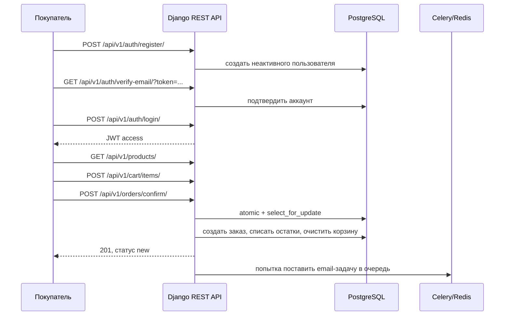

# Retail Procurement API — проверяемый сценарий покупки

Этот walkthrough основан на коде [интеграционного теста](../tests/test_integration.py), [URL-маршрутах](../api/urls.py), [OrderService](../orders_app/services.py) и не использует персональные данные. Это документация воспроизводимого тестового сценария, а не запись промышленной эксплуатации.

## Последовательность



## Шаги и ожидаемые результаты

| Шаг | HTTP-операция | Ожидаемый результат в тесте |
|---|---|---|
| Регистрация | `POST /api/v1/auth/register/` | `201`, аккаунт создан |
| Подтверждение | `GET /api/v1/auth/verify-email/?token=...` | `200`, пользователь активирован |
| Вход | `POST /api/v1/auth/login/` | `200`, получен JWT |
| Каталог | `GET /api/v1/products/` | `200`, тестовый товар присутствует |
| Корзина | `POST /api/v1/cart/items/` | `201`, количество товара 2 |
| Оформление | `POST /api/v1/orders/confirm/` | `201`, статус заказа `new` |
| Список заказов | `GET /api/v1/orders/` | `200`, созданный заказ найден |

### Пример запросов (только локальный тестовый стенд)

После создания тестового покупателя и товара, а также получения JWT:

```http
POST /api/v1/cart/items/ HTTP/1.1
Authorization: Bearer <test-access-token>
Content-Type: application/json

{"product_id": 1, "quantity": 2}
```

```http
POST /api/v1/orders/confirm/ HTTP/1.1
Authorization: Bearer <test-access-token>
Content-Type: application/json

{"address": "Тестовая, 1", "phone": "+79990000000"}
```

ID товара `1` условный: он должен существовать в **тестовой** БД и иметь достаточный остаток.

### Негативные сценарии

- Пустая корзина → `400` (тест `test_confirm_order_empty_cart`).
- Недостаточный остаток → `400` с сообщением об отсутствии товара (тест `test_confirm_order_insufficient_stock`).
- Успешная покупка → `201` (тест `test_confirm_order_success`).

`OrderService.create_order_from_cart` использует `transaction.atomic` и `select_for_update`; такой дизайн позволяет сериализовать операции на заблокированных строках товара. Описанные тесты подтверждают обычный и ошибочные сценарии, **но не являются отдельным нагрузочным доказательством отсутствия oversell при сотнях конкурентных заказов**.

## Как воспроизвести

В тестовом Docker-окружении с применёнными миграциями:

```bash
docker compose exec web pytest -q tests/test_integration.py tests/test_orders.py
```

Swagger после запуска: `http://localhost:8000/api/v1/docs/`.

Не используйте настоящие аккаунты, личные токены и реальные контакты покупателей для демонстрации.
